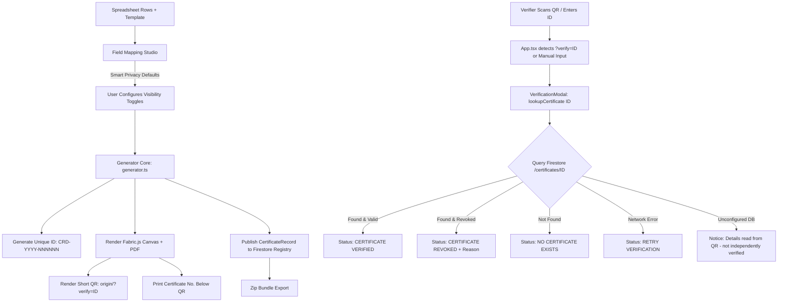

# Credora Certificate Verification System

This document details the architecture, cryptographic data flow, database schema, security rules, and setup instructions for the **Credora Certificate Verification & Registry Engine**.

---

## 1. Overview & Problem Solved

### Previous Vulnerability
In earlier versions, QR codes encoded recipient parameters directly into URL query strings (`?verify=ID&name=NAME`). The verification modal trusted this URL input without database confirmation, allowing anyone to craft a malicious URL and produce an "Authentic & Verified" badge.

### New Hardened Architecture
1. **Tamper-Proof Certificate IDs:** Every certificate receives a unique, non-sequential identifier formatted as `CRD-YYYY-NNNNNN` with cryptographic entropy and a deterministic checksum to prevent enumeration or sequential guessing.
2. **Short URL QR Codes:** The QR code encodes strictly the short canonical verification endpoint:
   `https://<domain>/?verify=CRD-YYYY-NNNNNN`
   No personal information, recipient names, or credential metadata are embedded in the QR payload.
3. **Database Registry Lookup:** Scanning the QR code or searching a certificate ID queries the cloud database registry (Firebase Firestore) by exact `cert_id`. The client never trusts URL parameters for validation.
4. **Privacy-Preserving Field Mapping:** Organizers control visibility per field via a toggle in the studio. Sensitive personal data (email, phone, address, national IDs) is excluded from the public verification record by default.
5. **No False Positives / Strict Fallbacks:** If an ID does not exist in the database, it produces an explicit non-green "Not Found" error state. When no cloud backend is configured, the system explicitly displays:
   > *"Details read from QR code — not independently verified"*
   and never uses the words *"authentic"* or *"verified"*.

---

## 2. Certificate Identifier Specification

- **Pattern:** `CRD-YYYY-NNNNNN`
  - `CRD`: Static Credora prefix.
  - `YYYY`: 4-digit issuance year (e.g., `2026`).
  - `NNNNNN`: 6 uppercase alphanumeric characters composed of:
    - 4 random entropy characters (base-36 without ambiguous characters `0`, `O`, `1`, `I`).
    - 2 checksum characters calculated using a modular hash over the year and entropy segment.
- **Engine File:** [`src/utils/certId.ts`](file:///src/utils/certId.ts)
- **Functions:**
  - `generateCertificateId()`: Generates a cryptographically strong, validated ID.
  - `validateCertificateIdFormat(id)`: Verifies regex structure and recalculates checksum.

---

## 3. Data Flow & Generation Pipeline



### Generation Step
1. During batch generation in [`src/utils/generator.ts`](file:///src/utils/generator.ts), each recipient row is assigned a unique `certId`.
2. Fields with `showOnVerification !== false` are compiled into a `publishedDetails` dictionary.
3. A `CertificateRecord` is assembled:
   ```typescript
   export interface CertificateRecord {
     cert_id: string; // Primary key (CRD-YYYY-NNNNNN)
     recipient_name: string;
     details: Record<string, any>;
     issued_at: string; // ISO 8601 timestamp
     issuer: string;
     status: 'valid' | 'revoked';
     revoked_reason?: string;
   }
   ```
4. All records in the batch are committed to Firestore via chunked batch writes using `batchPublishCertificates()` in [`src/services/registry.ts`](file:///src/services/registry.ts).

---

## 4. Firebase Firestore Configuration & Security Rules

### Step 1: Create a Firebase Project
1. Go to the [Firebase Console](https://console.firebase.google.com/).
2. Create a project named `credora-registry` (or your preferred name).
3. Under **Build**, select **Firestore Database** and create a database in production mode.

### Step 2: Configure Environment Variables
Copy `.env.example` to `.env` in the project root and provide your Firebase Web App credentials:

```bash
VITE_FIREBASE_API_KEY=AIzaSy...
VITE_FIREBASE_AUTH_DOMAIN=credora-registry.firebaseapp.com
VITE_FIREBASE_PROJECT_ID=credora-registry
VITE_FIREBASE_STORAGE_BUCKET=credora-registry.appspot.com
VITE_FIREBASE_MESSAGING_SENDER_ID=123456789012
VITE_FIREBASE_APP_ID=1:123456789012:web:abcdef123456
VITE_FIREBASE_MEASUREMENT_ID=G-XXXXXXXXXX
```

### Step 3: Firestore Security Rules
Deploy the following rules in the Firebase Console under **Firestore Database > Rules**.

These rules guarantee:
- **Public Read by Exact ID:** Anyone can look up a certificate by exact `cert_id` without authenticating.
- **No Directory Scraping:** Listing/querying the entire collection is strictly prohibited.
- **Restricted Writes:** Only authenticated creators can insert or update records.

```javascript
rules_version = '2';
service cloud.firestore {
  match /databases/{database}/documents {
    match /certificates/{certId} {
      // Allow public read of a single certificate by exact certId only
      // Collection queries / list operations are denied to prevent scraping
      allow get: if true;
      allow list: if false;

      // Allow write operations only for authenticated issuers or development sessions
      allow write: if request.auth != null;
    }
  }
}
```

> **Note for Local Testing / Offline Mode:**
> If `.env` is unconfigured, Credora operates in local session registry mode. Records generated in the current browser session are verified via local memory, while external scans clearly show the unverified fallback notice.

---

## 5. Verification Result States

The mobile-first verification modal ([`src/components/VerificationModal.tsx`](file:///src/components/VerificationModal.tsx)) displays one of 6 distinct states:

| State | Status Banner | Header | Visual Treatment | Action |
|---|---|---|---|---|
| **Valid** | `CERTIFICATE VERIFIED` | Emerald Green | Displays Recipient Name in large bold type, Certificate No., Issuer, Issue Date, and all published details. | Copy ID / Close |
| **Revoked** | `CERTIFICATE REVOKED` | Crimson Red | Displays Recipient Name struck through, revocation reason (if provided), and original issue details. | Re-enter ID / Close |
| **Not Found** | `NO CERTIFICATE WITH THIS NUMBER EXISTS` | Rose / Warning | Explicit red warning indicating no matching record exists in the official database. **Never displays green.** | Input field to re-enter ID |
| **Network Error** | `STATUS COULD NOT BE CHECKED` | Amber Yellow | Displays network diagnostic message. | "Retry Verification" button |
| **Loading** | Animated Skeleton | Neutral Gray | Shimmer effect across status bar, name, and details cards. | — |
| **Unverified Fallback** | `DETAILS READ FROM QR CODE — NOT INDEPENDENTLY VERIFIED` | Amber Notice | Displays recipient name from scan without the words "authentic" or "verified". | Manual Search / Notice |

---

## 6. Privacy & Field Mapping Controls

In Step 2 (**Map Fields**), each mapped item contains a **SHOW ON VERIFY PAGE** toggle:
- **Default Enabled (`true`):**
  - Recipient Name (`{{Name}}`)
  - Course, Event, or Degree Title
  - Issue Date
  - Certificate Number (`CRD-YYYY-NNNNNN`)
  - Static certificate text paragraphs
- **Default Disabled (`false`):**
  - Email addresses
  - Phone / Mobile numbers
  - Home / Mailing addresses
  - National identifiers (SSN, Aadhar, Passport)

Organizers can toggle visibility on or off with a single click before clicking "Continue to Export".

---

## 7. Manual Certificate Number Search

For recipients with printed or physically damaged certificates where QR scanning is impossible:
1. **Header Navigation:** Click the `VERIFY CERT #` button in the top navigation bar.
2. **Main Page Search Box:** Enter the certificate number (e.g. `CRD-2026-X8K9M2`) in the dedicated lookup form on the homepage and click `VERIFY NOW`.
3. **Modal Re-entry:** The verification window itself features a dedicated search input at the bottom allowing instant lookup of any other certificate number.

---

## 8. Verification Audit Checklist

- [x] `npm run build` compiles with 0 TypeScript errors.
- [x] Generated certificates render a unique `CRD-YYYY-NNNNNN` ID.
- [x] Certificate ID is printed directly under the QR code on the certificate.
- [x] QR code encodes strictly `origin + '/?verify=' + certId` with zero recipient parameters.
- [x] Batch generation publishes records to the database registry.
- [x] Scanning a valid QR code displays "Certificate verified" with recipient name and published details.
- [x] A made-up or tampered ID returns "No certificate with this number exists" and never displays green.
- [x] A revoked record displays "Certificate revoked" along with the revocation reason.
- [x] Unconfigured backend safely triggers the mandatory fallback notice.
